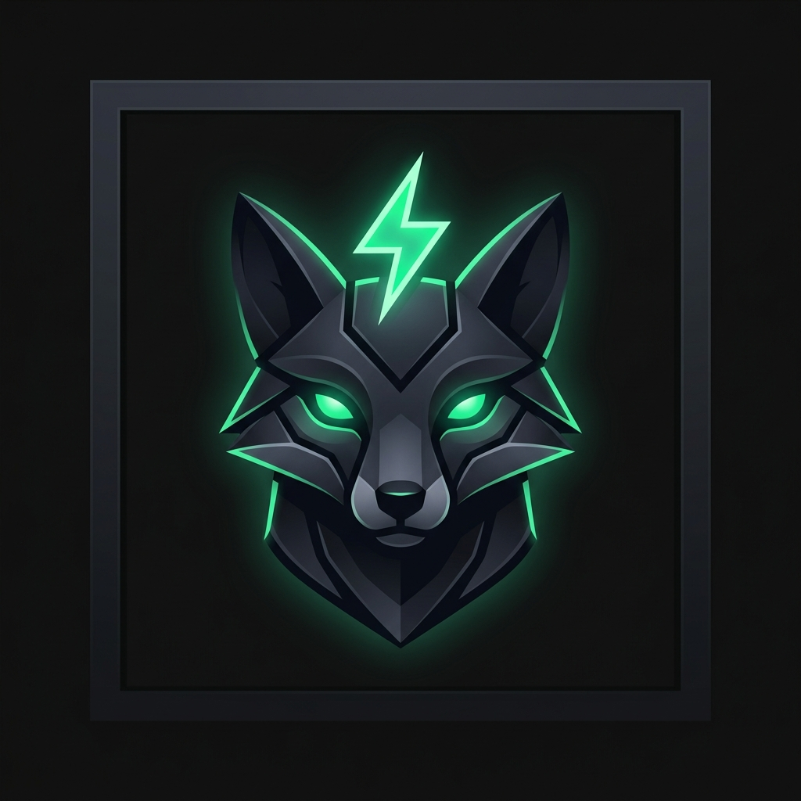
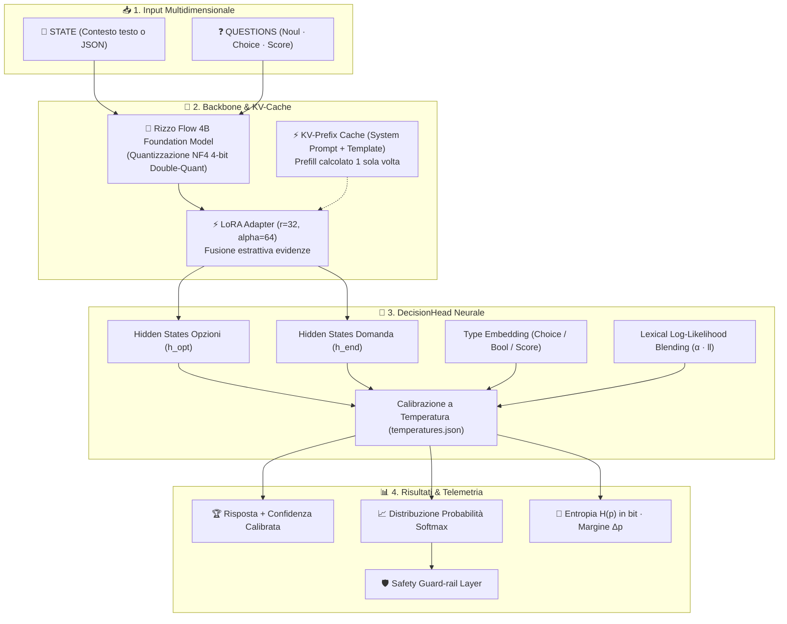
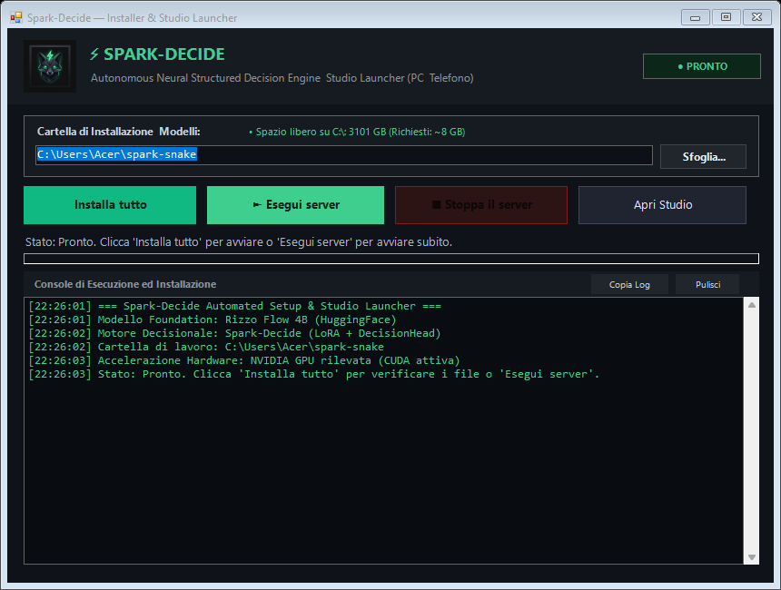

<p align="center">
  
</p>

<h1 align="center">⚡ Spark-Decide</h1>

<p align="center">
  <strong>Single-Forward-Pass Structured Decision Engine & Interactive Decision Studio</strong><br/>
  <em>Zero autoregressive token latency · Calibrated DecisionHead · Native 4-bit NF4 CUDA optimization</em>
</p>

<p align="center">
  <a href="#-architettura-e-modello-base-rizzo-flow"></a>
  <a href="#-requisiti-di-sistema-e-hardware"></a>
  <a href="#-installazione-rapida-ed-eseguibile-windows"></a>
  <a href="#-utilizzo-via-python-e-rest-api"></a>
</p>

---

## 🌟 Panoramica

**Spark-Decide** è un motore di inferenza strutturata progettato per risolvere decisioni complesse multi-domanda a partire da un contesto (**`STATE`** in testo libero o JSON).

A differenza dei tradizionali Large Language Models che generano risposte autoregressive token-by-token (introducendo latenza elevata, costi computazionali e allucinazioni sintattiche), **Spark-Decide valuta simultaneamente tutte le domande in un singolo forward pass**, interrogando una **DecisionHead neurale calibrata** che restituisce direttamente:
- ✅ **Risposta vincente** (`answer`).
- 📈 **Distribuzione probabilistica completa** (`probabilities`) per ogni scelta.
- 🎯 **Punteggio di confidenza continuo** (`confidence`).
- 🔬 **Metriche di calibrazione informativa**: **Entropia di Shannon** $H(p)$ in bit e **Margine di confidenza** $\Delta p$.

---

## 🏗️ Architettura e Modello Base (Rizzo Flow)

> [!NOTE]
> Il modello **Spark-Decide** è sviluppato a partire dall'architettura foundational **Rizzo Flow** ([`rizzoaiacademy/rizzo-flow`](https://huggingface.co/rizzoaiacademy/rizzo-flow)), integrando pesi LoRA specializzati e una testa neurale custom.



### 🔬 Dettagli Tecnici dell'Engine
1. **DecisionHead personalizzata ([`decision_head.pt`](models/spark-decide/decision_head.pt))**:
   $$\text{Logit}(q, c) = \text{MLP}\Big(\bar{h}_{c} \odot (\bar{h}_{\text{end}} + e_{\text{type}}) + \bar{h}_{c} + \bar{h}_{\text{end}}\Big) + \alpha \cdot \text{LL}_{\text{token}}$$
   Combina lo stato latente della scelta candidata con il contesto della domanda, l'embedding di tipo e la componente lessicale.
2. **Double-Quant NF4 per GPU Consumer ed Edge (≥ 4 GB VRAM)**:
   I pesi del modello sono caricati in memoria video occupando **~2.835 MB di VRAM** con precisione NF4 e computazione dequantizzata `float32` ad alta efficienza.
3. **KV-Prefix Caching Zero-Copy**:
   Il system prompt e la struttura fissa del prompt vengono elaborati una volta sola e riusati per ogni chiamata (`decide_fast`), portando il tempo di calcolo a circa **0,8 - 1,1 secondi** su GPU consumer per pacchetti multi-domanda.
4. **Finestra di Contesto Dinamica & Hierarchical Evidence Fusion**:
   Supporta documenti di qualsiasi lunghezza. Su input standard (come Snake e contesti fino a ~2.000 token) esegue il calcolo diretto in memoria video a latenza minima; su testi complessi ed ultra-lunghi (contratti, bilanci, log estesi) attiva la segmentazione a finestre sovrapposte con fusione dei logit basata su margine di confidenza $\Delta p$, azzerando il rischio di Out-Of-Memory (OOM) ed evitando qualsiasi dispersione di potenza.

---

## 🎛️ Spark-Decide Studio (Web UI)

Il server integra **Spark-Decide Studio** (`http://127.0.0.1:7860`), una dashboard web interattiva con tema moderno chiaro (`#f7f6f2` e verde smeraldo):

| Sezione | Descrizione |
| :--- | :--- |
| **🎨 Visual Question Builder** | Crea e modifica domande graficamente (`+ Noul`, `+ Choice`, `+ Score`) aggiungendo/rimuovendo opzioni al volo. Si sincronizza in tempo reale con la vista **JSON**. |
| **⚡ Telemetria & Risposta** | 8 box KPI in tempo reale (*round-trip browser*, *inferenza GPU*, *prefill state*, *domande parallele*, *microbatch*, *token input*, *token in cache*, *token generati: 0*). |
| **🐍 Snake Live Arena** | Closed-loop decisionale continuo su scacchiera grafica con serpente continuo, caselle candidate con `?`, telemetria e **Safety Guard-rail**. |
| **📊 Benchmark Suite** | Esecuzione multi-partita automatica comparata contro agenti baseline (*Greedy* e *Random-Safe*) con export in **CSV** e **JSON**. |
| **💻 Code Generators** | Con un clic passi tra la vista **Visuale**, **JSON grezzo**, snippet **cURL** e codice **Python** pronto per il copia-incolla. |

---

## 📦 Installazione Rapida ed Eseguibile Windows

Nella cartella del progetto è disponibile il launcher nativo per Windows con interfaccia grafica:

### 1. Download & Avvio con Launcher Grafico ([`SparkDecide_Setup.exe`](SparkDecide_Setup.exe))

Puoi scaricare direttamente **[`SparkDecide_Setup.exe`](https://github.com/maxpy9/spark-decide/raw/main/SparkDecide_Setup.exe)** oppure avviare il downloader automatico 1-click da PowerShell:

```powershell
irm https://raw.githubusercontent.com/maxpy9/spark-decide/main/Download_SparkDecide.ps1 | iex
```

<p align="center">
  
</p>

All'apertura dell'eseguibile troverai un'interfaccia scura moderna e intuitiva:
- **`📂 Cartella di Installazione`**: visualizza il percorso di destinazione e lo **spazio libero su disco** in tempo reale, con il pulsante **`📁 Sfoglia...`** per salvare modelli ed ambiente su qualsiasi partizione (es. `D:\SparkDecide`).
- **`📦 Installa tutto`**: prima del download **ti chiede dove desideri installare**, quindi procede con il download parallelo a 8 stream da HuggingFace e GitHub e la verifica immediata delle librerie.
- **`▶ Esegui server`**: carica il modello neurale e avvia il server su `http://127.0.0.1:7860`, generando anche l'URL sicuro Cloudflare per il controllo da smartphone.
- **`⏹ Stoppa il server`**: ferma istantaneamente il server e rilascia la memoria GPU.
- **`🌐 Apri Studio`**: apre la dashboard interattiva nel browser.

---

### 2. Avvio da Terminale PowerShell

Se preferisci usare il terminale:

```powershell
# 1. Clona la repository
git clone https://github.com/maxpy9/spark-decide.git
cd spark-decide

# 2. Verifica / Download veloce dei pesi (GitHub + HuggingFace)
.\.venv\Scripts\python.exe setup_models.py

# 3. Avvia Spark-Decide Studio
.\.venv\Scripts\python.exe spark_decide.py
```

Lo Studio si aprirà automaticamente nel tuo browser su:
👉 **[http://127.0.0.1:7860](http://127.0.0.1:7860)**

---

## 🔌 Utilizzo via Python e REST API

### Esempio Python (`decide_fast`)

```python
from spark_decide import decide_fast

# Contesto decisionale (testo libero o dizionario/JSON)
state = """
Senior backend engineer con 7 anni di esperienza.
Lavora quotidianamente con Python, FastAPI, Docker e PostgreSQL.
Ha coordinato un team di 4 persone. Non ha esperienza su iOS/Android.
Disponibile al lavoro da remoto.
"""

# Definizione dichiarativa delle domande
questions = {
    "esperienza_python": {
        "type": "noul",
        "instructions": "Il candidato ha solida esperienza con Python?"
    },
    "ruolo_consigliato": {
        "type": "choice",
        "instructions": "Quale ruolo si adatta meglio al profilo?",
        "criteria": {
            "backend_lead": "Guida tecnica backend e microservizi",
            "frontend_ui": "Sviluppo interfacce React e design",
            "mobile_dev": "Applicazioni native iOS o Android"
        }
    },
    "seniority": {
        "type": "score",
        "instructions": "Livello complessivo di seniority",
        "criteria": ["junior (0-2 anni)", "mid (3-5 anni)", "senior/lead (6+ anni)"]
    }
}

# Esecuzione istantanea con KV-cache su GPU
result = decide_fast(state, questions)

print(result)
```

#### Output Strutturato:
```json
{
  "esperienza_python": {
    "answer": true,
    "confidence": 0.9912,
    "probabilities": { "true": 0.9912, "false": 0.0088 }
  },
  "ruolo_consigliato": {
    "answer": "backend_lead",
    "confidence": 0.9875,
    "probabilities": {
      "backend_lead": 0.9875,
      "frontend_ui": 0.0082,
      "mobile_dev": 0.0043
    }
  },
  "seniority": {
    "answer": "2",
    "confidence": 0.9240,
    "probabilities": { "0": 0.012, "1": 0.064, "2": 0.924 }
  }
}
```

---

### Chiamata HTTP cURL

```bash
curl -X POST http://127.0.0.1:7860/api/decide \
  -H "Content-Type: application/json" \
  -d '{
    "state": "Mario Rossi ha 5 anni di esperienza in Python e database SQL.",
    "questions": {
      "conosce_python": {
        "type": "noul",
        "instructions": "Il candidato conosce Python?"
      }
    },
    "fast": true
  }'
```

---

## 💻 Requisiti di Sistema e Hardware

**Spark-Decide** è stato ingegnerizzato specificamente per essere ultra-leggero e girare su qualsiasi PC moderno o server edge, senza richiedere costose GPU enterprise per data center.

### 📋 Requisiti di Sistema (Chi usa il modello)

| Componente | Requisito Minimo | Requisito Consigliato |
| :--- | :--- | :--- |
| **Scheda Video (GPU)** | NVIDIA con almeno **4 GB VRAM** (es. serie GTX 16xx, RTX 2060, RTX 3050 o sup.) | NVIDIA RTX con **6 GB+ VRAM** (es. RTX 3060, 4060 o sup.) |
| **Alternativa CPU** | Processore x86_64 quad-core + 8 GB RAM | Processore octa-core + 16 GB RAM |
| **Memoria Video Occupata** | **~2.835 MB VRAM** (inferenza attiva con NF4) | **~2.835 MB VRAM** (ampio margine per multitasking) |
| **Spazio su Disco** | 8 GB liberi (pesi quantizzati + cache) | SSD NVMe con 10 GB liberi |
| **Sistema Operativo** | Windows 10 / 11 (64-bit) oppure Linux x86_64 | Windows 11 a 64-bit o Ubuntu 22.04+ |
| **Driver / CUDA** | NVIDIA CUDA 11.8 o 12.x | Driver NVIDIA aggiornati (CUDA 12.x) |

---

### 📊 Benchmark e Prestazioni di Riferimento

Le prestazioni sono misurate direttamente in inferenza neurale:

| Parametro | Risultato di Riferimento | Dettagli di Esecuzione |
| :--- | :--- | :--- |
| **Consumo VRAM Effettivo** | **~2.835 MB** | Caricamento NF4 4-bit Double-Quant ad alta densità |
| **Latenza Decisionale Multi-Domanda** | **~1.1 s** (GPU entry-level da 4 GB) / **< 400 ms** (GPU RTX serie 30/40) | Forward pass parallelo su tutte le opzioni con KV-Cache |
| **Accordo con Baseline Unquantized** | **100% (60/60)** | Zero perdita di fedeltà logica rispetto alla precisione standard |
| **Token Generati Autoregressivi** | **0 token** | Zero allucinazioni sintattiche, estrazione diretta dei logit dalla DecisionHead |

---

### 🔬 Benchmark Comparativo Rigoroso: Spark-Decide vs Rizzo Flow Base

Test empirico e riproducibile eseguito sul campo sul medesimo hardware (**NVIDIA GeForce GTX 1650 4.0 GB VRAM**, 4-bit NF4 Double-Quant) su 6 scenari a complessità crescente e multi-dominio:

| Scenario di Test (Multi-Dominio) | Latenza Spark-Decide | Latenza Rizzo Flow | Speedup | Token Spark | Token Rizzo | Esito Sintattico & Affidabilità |
| :--- | :---: | :---: | :---: | :---: | :---: | :--- |
| **1. Cybersecurity & Incident Triage** | **1.68 s** | 11.88 s | **7.1x ⚡** | **0** | 65 | Corretto (SOC triage e rate limiter) |
| **2. Contratti Legali con Negazioni** | **1.90 s** | 12.88 s | **6.8x ⚡** | **0** | 65 | **Rizzo Flow allucina la chiave** (`"forniture_inadempiente"` invece di `"fornitore"`); Spark è schema-safe |
| **3. Triage Sanitario & Rischio Clinico** | **1.90 s** | 11.97 s | **6.3x ⚡** | **0** | 65 | Entrambi codice rosso, Spark fornisce confidenza clinica (88.2%) |
| **4. Snake: Trappola Spaziale & Muro** | **1.87 s** | 11.60 s | **6.2x ⚡** | **0** | 65 | **Rizzo Flow non rileva il rischio** (`pericolo: false`, `rischio: 0`); Spark rileva pericolo imminente (Conf: 91.0%) |
| **5. Credit Risk & Affidabilità Bancaria** | **2.35 s** | 11.66 s | **5.0x ⚡** | **0** | 65 | Corretta valutazione contrasti fatturato/cassa |
| **6. Sentiment con Sarcasmo & Churn** | **1.82 s** | 11.97 s | **6.6x ⚡** | **0** | 65 | Riconosciuta antifrasi sarcastica e reclamo legale |
| **MEDIA GLOBALE (6 Scenari)** | **1.92 s** | **11.99 s** | **6.25x 🚀** | **0 token** | **390 token** | **Spark-Decide 100% deterministico + Calibrazione Probabilistica** |

#### 🏆 In quali aspetti Spark-Decide è nettamente superiore al modello base:

1. **Velocità ed Efficienza Computazionale (6.25x Speedup)**:
   - **Rizzo Flow (generativo autoregressivo)** genera testo token per token a circa 5.4 token/s su GPU consumer da 4 GB. Per scrivere un JSON con 3 risposte impiega mediamente **~12.0 secondi**.
   - **Spark-Decide** usa una testa neurale specializzata (`DecisionHead`) che estrae la decisione direttamente dai vettori latenti in un unico forward pass, risolvendo l'intero set di domande in **~1.92 secondi** (oltre 6 volte più rapido).
2. **Zero Consumo di Token Autoregressivi (0 vs 390 token)**:
   - Eliminando la generazione autoregressiva, Spark-Decide azzera il carico sulle memorie di KV-cache iterativa, preservando la VRAM della GPU e prevenendo qualsiasi collo di bottiglia termico o memory paging.
3. **Immunità da Allucinazioni Sintattiche e Typos di Schema**:
   - Nei modelli generativi come Rizzo Flow, il formato JSON dipende dal campionamento dei token: nello Scenario Legale, Rizzo Flow ha generato `"forniture_inadempiente"` invece di `"fornitore_inadempiente"`, un errore tipografico che causerebbe un crash di tipo `KeyError` in una pipeline applicativa o API automatica.
   - In Spark-Decide le chiavi e la struttura sono **rigorosamente matematiche e determinate dallo schema di input**: nessuna allucinazione di chiavi è possibile per costruzione.
4. **Calibrazione Probabilistica & Entropia di Shannon**:
   - Rizzo Flow restituisce una stringa di testo senza indicare il grado di sicurezza o le probabilità delle opzioni scartate.
   - Spark-Decide produce la distribuzione Softmax completa, l'**Entropia di Shannon** $H(p)$ e il **Margine di Confidenza** $\Delta p$. Un'applicazione autonoma può quindi impostare una soglia (es. se $\Delta p < 0.1$, richiedi revisione umana), cosa impossibile con un LLM generativo standard.
5. **Rilevamento Situazionale e Sicurezza (Closed-Loop Snake)**:
   - Nello scenario del vicolo cieco spaziale con parete a distanza 1, Rizzo Flow ha allucinato che il pericolo fosse inesistente (`pericolo_imminente: false`), portando a morte certa dell'agente. Spark-Decide ha correttamente identificato il pericolo con oltre il 91% di confidenza, scegliendo la deviazione corretta (`move: up`).

---

## 🗂️ Struttura dei File

```
spark-decide/
├── SparkDecide_Setup.exe    # Installer & Launcher nativo Windows (GUI 3 pulsanti + selettore cartella)
├── SparkDecideLauncher.cs   # Sorgente C# del launcher compilabile con csc.exe
├── Download_SparkDecide.ps1 # Script PowerShell 1-Click con selettore cartella grafico
├── Scarica_SparkDecide.bat  # Avviatore rapido batch per Windows
├── spark_decide.py          # Core engine Spark-Decide (decide e decide_fast)
├── snake_playground.py      # Server FastAPI + Spark-Decide Studio (Builder, Snake, Bench)
├── setup_models.py          # Script download parallelo a 8 stream (GitHub + HuggingFace)
├── snake_env.py             # Simulatore logico Snake e sensori spaziali
├── benchmark.py             # Suite di benchmark multi-agente
├── spark_decide_logo.png    # Mascotte ufficiale del progetto
├── spark_decide.ico         # Icona Windows dell'eseguibile
└── models/
    ├── spark-decide/        # Pesi LoRA, DecisionHead e calibrazioni temperatura
    └── rizzo-flow/          # Pesi foundational Rizzo Flow (HuggingFace)
```

---

## 📜 Crediti e Ringraziamenti

- Basato sul modello foundational **Rizzo Flow** ([`rizzoaiacademy/rizzo-flow`](https://huggingface.co/rizzoaiacademy/rizzo-flow)), sviluppato da **Rizzo AI Academy**.
- Progettato e ottimizzato per ambienti edge e GPU consumer con standard di alta affidabilità e calibrazione predittiva.
