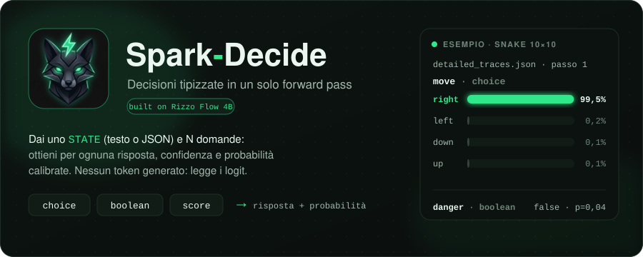
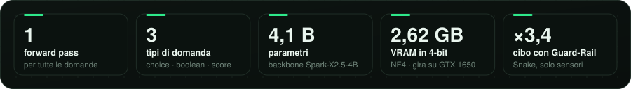
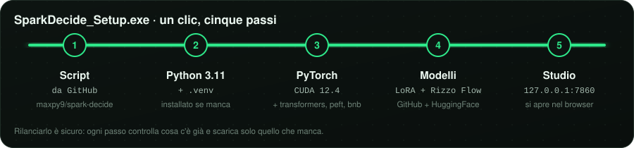
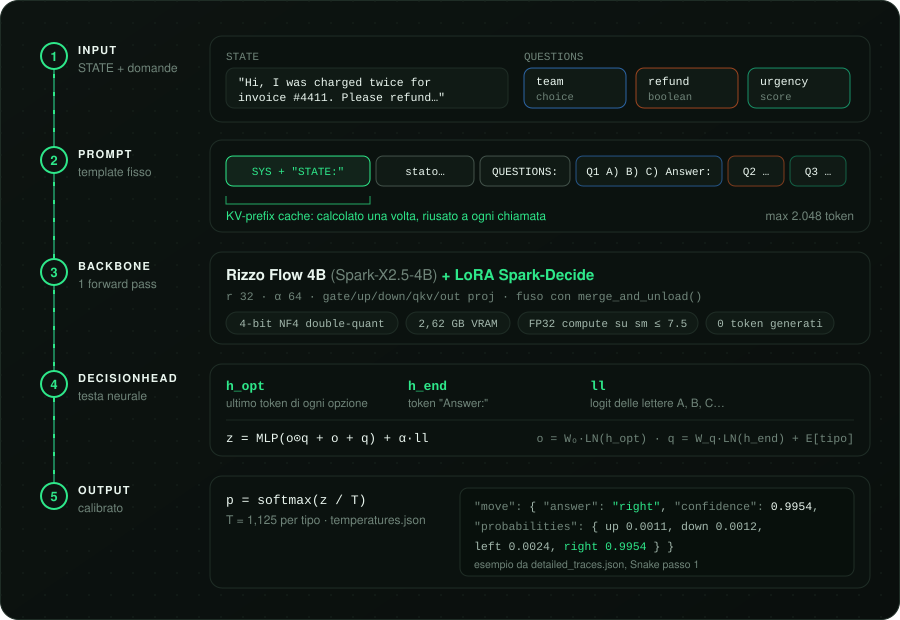
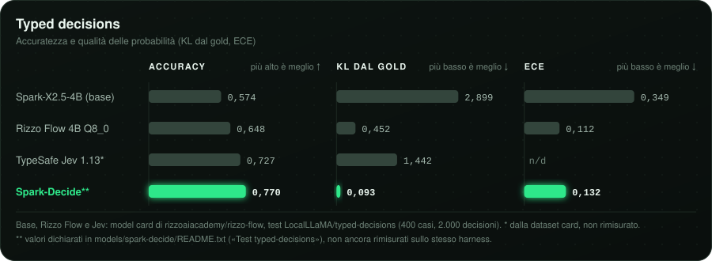
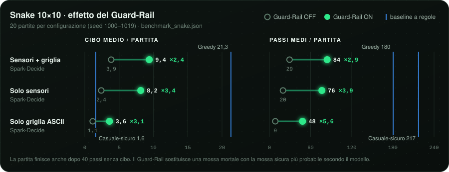
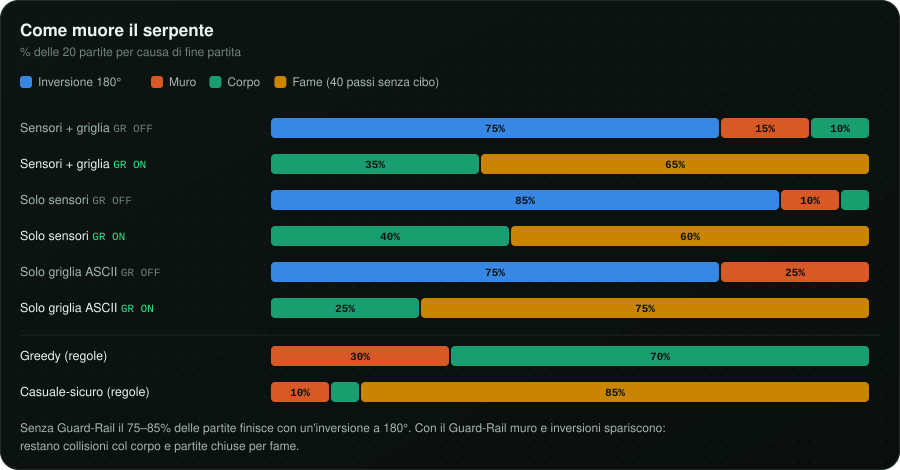
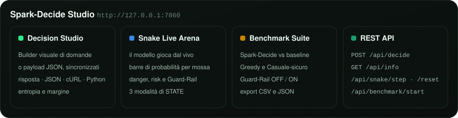

<p align="center">
  
</p>

<p align="center">
  <a href="#installazione"></a>
  
  
  
  <a href="https://huggingface.co/rizzoaiacademy/rizzo-flow"></a>
</p>

<p align="center">
  <a href="#cose"><b>Cos'è</b></a> ·
  <a href="#installazione"><b>Installazione</b></a> ·
  <a href="#come-funziona"><b>Come funziona</b></a> ·
  <a href="#benchmark"><b>Benchmark</b></a> ·
  <a href="#uso"><b>Python & REST</b></a> ·
  <a href="#studio"><b>Studio</b></a>
</p>

<p align="center">
  
</p>

<a id="cose"></a>

## ⚡ Cos'è

**Spark-Decide** è un motore decisionale: gli passi uno **`STATE`** (testo libero o JSON) e un dizionario di **domande tipizzate**, e lui risponde a tutte insieme con **un solo forward pass**. Per ogni domanda restituisce la risposta, la confidenza e la distribuzione di probabilità su tutte le opzioni.

Non genera testo: legge gli stati nascosti del modello e li passa a una **DecisionHead** calibrata. Per questo è veloce, deterministico e facile da collegare a codice che deve prendere decisioni (routing di ticket, screening, anti-frode, controllo di agenti, giochi).

| Tipo | Alias | `criteria` | `answer` |
| :-- | :-- | :-- | :-- |
| `choice` | | `{chiave: descrizione}` oppure lista | la chiave scelta |
| `boolean` | `noul`, `bool` | opzionale `{"true": "...", "false": "..."}` | `true` / `false` |
| `score` | | lista di livelli, dal più basso al più alto | l'indice del livello (`"0"`, `"1"`, …) |

Fino a 26 opzioni per domanda (lettere `A`–`Z`); `STATE` + domande stanno in 2.048 token, e lo `STATE` viene troncato se serve.

Include **Spark-Decide Studio**, una web app locale su `http://127.0.0.1:7860` per provare il modello su qualsiasi task, guardarlo giocare a **Snake** in tempo reale e lanciare la **suite di benchmark**.

<a id="installazione"></a>

## 🚀 Installazione

<p align="center">
  
</p>

### Opzione A · Windows, un clic (consigliata)

1. Scarica **[`SparkDecide_Setup.exe`](SparkDecide_Setup.exe)** e mettilo in una cartella vuota: diventerà la cartella del progetto.
2. Avvialo e premi il pulsante verde **⚡ Scarica Tutto (GitHub + HF) & Avvia Spark-Decide**.
3. Al termine **Spark-Decide Studio** si apre da solo su **http://127.0.0.1:7860**.

L'installer scarica gli script da questo repository, installa Python 3.11.9 se manca, crea `.venv`, installa PyTorch CUDA 12.4 con le librerie AI, scarica i pesi Spark-Decide (da qui) e il backbone Rizzo Flow (da HuggingFace), poi avvia il server. I pulsanti **🌐 Apri Studio** e **⏹ Stop** restano disponibili nella finestra.

### Opzione B · Da terminale

<table>
<tr><th>Windows (PowerShell)</th><th>Linux</th></tr>
<tr>
<td>

```powershell
git clone https://github.com/maxpy9/spark-decide.git
cd spark-decide
python -m venv .venv
.\.venv\Scripts\Activate.ps1
```

</td>
<td>

```bash
git clone https://github.com/maxpy9/spark-decide.git
cd spark-decide
python3 -m venv .venv
source .venv/bin/activate
```

</td>
</tr>
</table>

Poi, in entrambi i casi:

```bash
pip install torch --index-url https://download.pytorch.org/whl/cu124
pip install "transformers>=4.51,<5" "peft>=0.13,<0.18" accelerate bitsandbytes
pip install fastapi uvicorn safetensors huggingface_hub
python setup_models.py     # ricompone il LoRA e scarica Rizzo Flow (8,2 GB)
python spark_decide.py     # test in console + Studio su http://127.0.0.1:7860
```

| Opzione | Effetto |
| :-- | :-- |
| `python spark_decide.py --no-browser` | avvia lo Studio senza aprire il browser |
| `python spark_decide.py --test-only` | esegue solo il test in console ed esce |
| `SPARK_DISABLE_4BIT=1` | disattiva il caricamento 4-bit anche su GPU con meno di 9 GB |

### Requisiti

| Cosa | Serve |
| :-- | :-- |
| 🎮 **GPU** | NVIDIA con **4 GB di VRAM** (riferimento: GTX 1650). Sotto i 9 GB si attiva da solo il **4-bit NF4** (2,62 GB); dai 9 GB in su il modello resta in bf16/fp16. |
| 💾 **Disco** | ~17 GB: Rizzo Flow 8,2 GB, modello fuso locale ~8 GB, LoRA 0,25 GB. |
| 🧠 **RAM** | 16 GB consigliati: al primo avvio in 4-bit il LoRA viene fuso nel backbone sulla CPU, una volta sola. |
| 🖥️ **OS** | Windows 10/11 per l'installer `.exe`; Linux con CUDA da terminale. Il codice prevede anche Apple Silicon (MPS) e CPU, senza 4-bit e molto più lenti. |

<a id="come-funziona"></a>

## 🧠 Come funziona

<p align="center">
  
</p>

1. **Prompt.** `STATE` e domande diventano un unico prompt: system prompt, `STATE:`, poi ogni domanda con le opzioni `A) B) C) …` e `Answer:`.
2. **Backbone.** [Rizzo Flow 4B](https://huggingface.co/rizzoaiacademy/rizzo-flow) (Spark-X2.5-4B) con il **LoRA Spark-Decide** (`r 32`, `α 64`) fuso nei pesi. Un solo forward pass, zero token generati.
3. **DecisionHead.** Per ogni opzione combina `h_opt` (ultimo token dell'opzione), `h_end` (token `Answer:`), un embedding del tipo di domanda e `ll`, i logit delle lettere: `z = MLP(o⊙q + o + q) + α·ll`.
4. **Calibrazione.** `softmax(z / T)` con temperatura per tipo da [`temperatures.json`](models/spark-decide/temperatures.json) (`T ≈ 1,125`).

**`decide_fast`** fa la stessa cosa di `decide()` ma calcola **una volta sola** il KV-cache del prefisso fisso, mette in cache la tokenizzazione delle domande e, in 4-bit, riusa i buffer di dequantizzazione sulla GPU. Su GPU senza Tensor Core FP16 veloci (compute capability ≤ 7.5, come la GTX 1650) il calcolo avviene in FP32. [`eq_test.py`](eq_test.py) confronta `decide()` e `decide_fast()` posizione per posizione.

<a id="benchmark"></a>

## 📊 Benchmark

### Come si posiziona

<p align="center">
  
</p>

Sul task *typed decisions* Spark-Decide dichiara **accuracy 0,770** e **KL 0,093**, sopra il backbone Rizzo Flow da cui parte (0,648 e 0,452). L'**ECE** di 0,132 è invece un po' sopra quello di Rizzo Flow (0,112). I numeri di Spark-Decide vengono da [`models/spark-decide/README.txt`](models/spark-decide/README.txt) e non sono ancora stati rimisurati con lo stesso harness della [model card di Rizzo Flow](https://huggingface.co/rizzoaiacademy/rizzo-flow), quindi il confronto è indicativo.

### Snake 10×10: il modello come agente

Lo stesso modello, senza addestramento specifico, gioca a Snake rispondendo ogni passo a tre domande: `move` (choice), `danger` (boolean), `risk` (score). Lo `STATE` può essere **sensori + griglia ASCII**, **solo sensori** o **solo griglia**. Il **Guard-Rail** sostituisce una mossa mortale con la mossa sicura che il modello considera più probabile.

<p align="center">
  
</p>

<p align="center">
  
</p>

**In breve:**

- 🛡️ Il Guard-Rail moltiplica il cibo medio per **×2,4–3,4** e allunga le partite di **×2,9–5,6**.
- 🧭 Senza Guard-Rail il modello sceglie una mossa sicura nell'**88–97%** dei passi, ma l'errore che resta è quasi sempre un'**inversione a 180°**.
- 📡 I **sensori** contano più della griglia: con la sola griglia ASCII il modello rende meno della metà.
- 📏 Un agente **Greedy** scritto a mano resta avanti (21,3 cibo medio): Spark-Decide è un motore decisionale generale, non un bot di Snake.

<details>
<summary><b>📋 Tabella completa</b> (<a href="benchmark_snake.csv">benchmark_snake.csv</a> · <a href="benchmark_snake.json">benchmark_snake.json</a>)</summary>

<br/>

| Agente | STATE | Guard-Rail | Cibo medio | Cibo max | Passi medi | Mosse sicure (raw) | Fix GR | Muro | Corpo | Inversione 180° | Fame |
| :-- | :-- | :-: | --: | --: | --: | --: | --: | --: | --: | --: | --: |
| Spark-Decide | sensori + griglia | OFF | 3,85 | 7 | 29,4 | 96,6% | 0 | 15% | 10% | 75% | 0% |
| Spark-Decide | sensori + griglia | **ON** | **9,40** | **16** | 84,2 | 94,8% | 88 | 0% | 35% | 0% | 65% |
| Spark-Decide | solo sensori | OFF | 2,40 | 5 | 19,8 | 94,4% | 0 | 10% | 5% | 85% | 0% |
| Spark-Decide | solo sensori | **ON** | 8,15 | 14 | 76,5 | 92,1% | 121 | 0% | 40% | 0% | 60% |
| Spark-Decide | solo griglia ASCII | OFF | 1,15 | 2 | 8,6 | 88,4% | 0 | 25% | 0% | 75% | 0% |
| Spark-Decide | solo griglia ASCII | **ON** | 3,60 | 7 | 48,3 | 81,2% | 182 | 0% | 25% | 0% | 75% |
| Baseline Greedy | sensori (regole) | n/a | 21,30 | 38 | 180,5 | 99,4% | 0 | 30% | 70% | 0% | 0% |
| Baseline Casuale-sicuro | sensori (regole) | n/a | 1,60 | 5 | 217,4 | 99,9% | 0 | 10% | 5% | 0% | 85% |

20 partite per configurazione, griglia 10×10, seed 1000–1019. Una partita finisce anche dopo 40 passi senza mangiare (colonna *Fame*).

</details>

> [!NOTE]
> **Latenza.** Il run salvato in `benchmark_snake.json` registra un p50 di 8,8 s (solo griglia) – 17,0 s (sensori + griglia) per mossa. Il percorso `decide_fast` ottimizzato è indicato a **~1,07–1,80 s per mossa su GTX 1650**. Per misurare la tua GPU rilancia il benchmark.

**Riprodurre i benchmark:**

```bash
python benchmark.py --games 20 --size 10    # scrive benchmark_snake.csv e benchmark_snake.json
```

Oppure dalla scheda **Benchmark** dello Studio, che mostra l'avanzamento e permette di scaricare CSV e JSON.

<a id="uso"></a>

## 🔌 Uso da Python e REST

### Python

```python
from spark_decide import decide, decide_fast

state = "Hi, I was charged twice for invoice #4411. Please refund the duplicate today."
questions = {
    "team": {
        "type": "choice",
        "instructions": "Which team should handle this?",
        "criteria": {
            "billing": "invoices, payments, refunds",
            "technical": "bugs, outages",
            "sales": "pricing, plans",
        },
    },
    "refund": {"type": "noul", "instructions": "Does the customer ask for a refund?"},
    "urgency": {
        "type": "score",
        "instructions": "How urgent is this?",
        "criteria": ["not urgent", "soon", "today"],
    },
}

out = decide_fast(state, questions)   # stessa logica di decide(), con KV-prefix cache
print(out["team"]["answer"], out["team"]["confidence"])
```

**Formato della risposta.** Ogni domanda diventa una chiave con `answer`, `confidence` e `probabilities`. Per esempio la domanda `move` al passo 1 di [`detailed_traces.json`](detailed_traces.json) (Snake, sensori + griglia):

```json
{
  "move": {
    "answer": "right",
    "confidence": 0.9954,
    "probabilities": { "up": 0.0011, "down": 0.0012, "left": 0.0024, "right": 0.9954 }
  }
}
```

Per una domanda `boolean`, `answer` è `true`/`false` e le chiavi di `probabilities` sono `"true"` e `"false"`; per uno `score` sono gli indici dei livelli.

### REST API

Con lo Studio avviato:

```bash
curl -X POST http://127.0.0.1:7860/api/decide \
  -H "Content-Type: application/json" \
  -d '{
    "state": "Hi, I was charged twice for invoice #4411.",
    "questions": {
      "refund": {"type": "noul", "instructions": "Does the customer ask for a refund?"}
    },
    "fast": true
  }'
```

La risposta contiene `result` (le decisioni, con in più `entropy_bits` e `margin` per ogni domanda), `latency_ms`, `prompt_tokens`, `cached_state_tokens`, `parallel_questions` ed `engine`. Con `"fast": false` usa `decide()` invece di `decide_fast()`.

| Endpoint | Cosa fa |
| :-- | :-- |
| `POST /api/decide` | decide su `state` + `questions` |
| `GET /api/info` | GPU, VRAM, modalità 4-bit |
| `GET /api/snake/state` · `POST /api/snake/reset` · `POST /api/snake/step` | partita di Snake guidata dal modello |
| `POST /api/benchmark/start` · `GET /api/benchmark/status` | lancia e segue la suite di benchmark |
| `GET /api/benchmark/download/{csv,json}` | scarica i risultati |

<a id="studio"></a>

## 🖥️ Spark-Decide Studio

<p align="center">
  
</p>

- **Decision Studio:** costruisci le domande con il Builder visuale (`+ Noul`, `+ Choice`, `+ Score`) o scrivi il JSON a mano; i due restano sincronizzati. Esempi pronti: screening CV, rimborsi, anti-frode, telemetria IoT. La risposta si vede come barre, JSON, cURL o Python.
- **Snake Live Arena:** il modello gioca dal vivo, con probabilità di ogni mossa, `danger`, `risk`, Guard-Rail e registro delle decisioni. Disattiva **⚡ Turbo 60fps** (acceso di default) per vedere il modello: in Turbo le mosse arrivano dalla policy Greedy, con probabilità simulate.
- **Benchmark Suite:** confronta Spark-Decide con le baseline Greedy e Casuale-sicuro, con e senza Guard-Rail.

## 📁 Struttura del repository

```text
spark-decide/
├── SparkDecide_Setup.exe        Installer e launcher Windows (sorgente: SparkDecideLauncher.cs)
├── spark_decide.py              Motore: decide(), decide_fast(), DecisionHead, caricamento 4-bit
├── snake_playground.py          Server FastAPI + Spark-Decide Studio + REST API
├── snake_env.py                 Snake NxN: sensori, flood-fill, griglia ASCII, baseline
├── benchmark.py                 Suite multi-modalità con Guard-Rail OFF/ON e baseline
├── eq_test.py                   Test di equivalenza decide() ↔ decide_fast()
├── setup_models.py              Download da GitHub + HuggingFace, ricomposizione del LoRA
├── benchmark_snake.{csv,json}   Risultati del benchmark
├── detailed_traces.json         Tracce passo per passo (sensori, probabilità, latenza)
├── assets/readme/               Grafiche di questo README
└── models/spark-decide/
    ├── adapter_config.json                  LoRA r 32, α 64
    ├── adapter_model.safetensors.part{1,2,3} pesi LoRA (ricomposti da setup_models.py)
    ├── decision_head.pt                     DecisionHead
    └── temperatures.json                    temperature di calibrazione per tipo
```

## 🙏 Crediti

- **[Rizzo Flow](https://github.com/Rizzo-AI-Academy/rizzo-flow)** di Rizzo AI Academy: il backbone e il formato delle decisioni tipizzate su cui è costruito Spark-Decide ([pesi su HuggingFace](https://huggingface.co/rizzoaiacademy/rizzo-flow), Apache-2.0).
- **[Spark-X2.5-4B](https://huggingface.co/XHToken/Spark-X2.5-4B)** di XHToken: il modello base di Rizzo Flow.
- Alcuni dataset usati per addestrare Rizzo Flow hanno licenze CC-BY e CC-BY-SA: vedi la sezione *Licenses of the training data* della sua model card prima di ridistribuire derivati.

<p align="center">
  <br/>
  <sub>Fatto con ⚡ da <a href="https://github.com/maxpy9">@maxpy9</a></sub>
</p>
