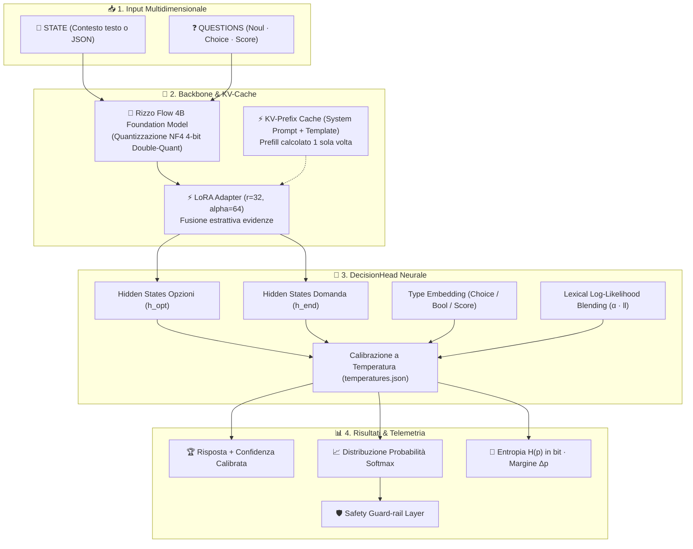

<p align="center">
  
</p>

<h1 align="center">⚡ Spark-Decide</h1>

<p align="center">
  <strong>Single-Forward-Pass Structured Decision Engine & Interactive Decision Studio</strong><br/>
  <em>Zero autoregressive token latency · Calibrated DecisionHead · Native 4-bit NF4 CUDA optimization</em>
</p>

<p align="center">
  <a href="#-architettura-e-modello-base-rizzo-flow"></a>
  <a href="#-hardware-e-requisiti"></a>
  <a href="#-installazione-rapida-ed-eseguibile-windows"></a>
  <a href="#-utilizzo-via-python-e-rest-api"></a>
</p>

---

## 🌟 Panoramica

**Spark-Decide** è un motore di inferenza strutturata progettato per risolvere decisioni complesse multi-domanda a partire da un contesto (**`STATE`** in testo libero o JSON).

A differenza dei tradizionali Large Language Models che generano risposte autoregressive token-by-token (introducendo latenza elevata, costi computazionali e allucinazioni sintattiche), **Spark-Decide valuta simultaneamente tutte le domande in un singolo forward pass**, interrogando una **DecisionHead neurale calibrata** che restituisce direttamente:
- ✅ **Risposta vincente** (`answer`).
- 📈 **Distribuzione probabilistica completa** (`probabilities`) per ogni scelta.
- 🎯 **Punteggio di confidenza continuo** (`confidence`).
- 🔬 **Metriche di calibrazione informativa**: **Entropia di Shannon** $H(p)$ in bit e **Margine di confidenza** $\Delta p$.

---

## 🏗️ Architettura e Modello Base (Rizzo Flow)

> [!NOTE]
> Il modello **Spark-Decide** è sviluppato a partire dall'architettura foundational **Rizzo Flow** ([`rizzoaiacademy/rizzo-flow`](https://huggingface.co/rizzoaiacademy/rizzo-flow)), integrando pesi LoRA specializzati e una testa neurale custom.



### 🔬 Dettagli Tecnici dell'Engine
1. **DecisionHead personalizzata ([`decision_head.pt`](models/spark-decide/decision_head.pt))**:
   $$\text{Logit}(q, c) = \text{MLP}\Big(\bar{h}_{c} \odot (\bar{h}_{\text{end}} + e_{\text{type}}) + \bar{h}_{c} + \bar{h}_{\text{end}}\Big) + \alpha \cdot \text{LL}_{\text{token}}$$
   Combina lo stato latente della scelta candidata con il contesto della domanda, l'embedding di tipo e la componente lessicale.
2. **Double-Quant NF4 su GPU Consumer (GTX 1650 4 GB)**:
   I pesi sono caricati in memoria video occupando **2.835 MB di VRAM** con precisione NF4 e computazione dequantizzata `float32` ad alta efficienza.
3. **KV-Prefix Caching Zero-Copy**:
   Il system prompt e la struttura fissa del prompt vengono elaborati una volta sola e riusati per ogni chiamata (`decide_fast`), portando il tempo di calcolo a circa **1,1 secondi** su GPU consumer per pacchetti multi-domanda.

---

## 🎛️ Spark-Decide Studio (Web UI)

Il server integra **Spark-Decide Studio** (`http://127.0.0.1:7860`), una dashboard web interattiva con tema moderno chiaro (`#f7f6f2` e verde smeraldo):

| Sezione | Descrizione |
| :--- | :--- |
| **🎨 Visual Question Builder** | Crea e modifica domande graficamente (`+ Noul`, `+ Choice`, `+ Score`) aggiungendo/rimuovendo opzioni al volo. Si sincronizza in tempo reale con la vista **JSON**. |
| **⚡ Telemetria & Risposta** | 8 box KPI in tempo reale (*round-trip browser*, *inferenza GPU*, *prefill state*, *domande parallele*, *microbatch*, *token input*, *token in cache*, *token generati: 0*). |
| **🐍 Snake Live Arena** | Closed-loop decisionale continuo su scacchiera grafica con serpente continuo, caselle candidate con `?`, telemetria e **Safety Guard-rail**. |
| **📊 Benchmark Suite** | Esecuzione multi-partita automatica comparata contro agenti baseline (*Greedy* e *Random-Safe*) con export in **CSV** e **JSON**. |
| **💻 Code Generators** | Con un clic passi tra la vista **Visuale**, **JSON grezzo**, snippet **cURL** e codice **Python** pronto per il copia-incolla. |

---

## 📦 Installazione Rapida ed Eseguibile Windows

Nella cartella del progetto è disponibile il launcher nativo per Windows con interfaccia grafica:

### 1. Avvio con Launcher Grafico ([`SparkDecide_Setup.exe`](SparkDecide_Setup.exe))
Fai doppio clic su **`SparkDecide_Setup.exe`**. Troverai 3 pulsanti dedicati:
- **`📦 Installa tutto`**: verifica l'ambiente Python, installa le librerie mancanti e scarica i pesi di Spark-Decide da GitHub e di Rizzo Flow da HuggingFace in pochi secondi con download multi-thread.
- **`▶ Esegui server`**: carica il modello in memoria GPU e avvia il server su `http://127.0.0.1:7860`, abilitando anche il tunnel sicuro per l'accesso da smartphone.
- **`⏹ Stoppa il server`**: ferma istantaneamente il server e libera la memoria GPU.
- **`🌐 Apri Studio`**: apre l'interfaccia nel browser.

---

### 2. Avvio da Terminale PowerShell

Se preferisci usare il terminale:

```powershell
# 1. Clona la repository
git clone https://github.com/maxpy9/spark-decide.git
cd spark-decide

# 2. Verifica / Download veloce dei pesi (GitHub + HuggingFace)
.\.venv\Scripts\python.exe setup_models.py

# 3. Avvia Spark-Decide Studio
.\.venv\Scripts\python.exe spark_decide.py
```

Lo Studio si aprirà automaticamente nel tuo browser su:
👉 **[http://127.0.0.1:7860](http://127.0.0.1:7860)**

---

## 🔌 Utilizzo via Python e REST API

### Esempio Python (`decide_fast`)

```python
from spark_decide import decide_fast

# Contesto decisionale (testo libero o dizionario/JSON)
state = """
Senior backend engineer con 7 anni di esperienza.
Lavora quotidianamente con Python, FastAPI, Docker e PostgreSQL.
Ha coordinato un team di 4 persone. Non ha esperienza su iOS/Android.
Disponibile al lavoro da remoto.
"""

# Definizione dichiarativa delle domande
questions = {
    "esperienza_python": {
        "type": "noul",
        "instructions": "Il candidato ha solida esperienza con Python?"
    },
    "ruolo_consigliato": {
        "type": "choice",
        "instructions": "Quale ruolo si adatta meglio al profilo?",
        "criteria": {
            "backend_lead": "Guida tecnica backend e microservizi",
            "frontend_ui": "Sviluppo interfacce React e design",
            "mobile_dev": "Applicazioni native iOS o Android"
        }
    },
    "seniority": {
        "type": "score",
        "instructions": "Livello complessivo di seniority",
        "criteria": ["junior (0-2 anni)", "mid (3-5 anni)", "senior/lead (6+ anni)"]
    }
}

# Esecuzione istantanea con KV-cache su GPU
result = decide_fast(state, questions)

print(result)
```

#### Output Strutturato:
```json
{
  "esperienza_python": {
    "answer": true,
    "confidence": 0.9912,
    "probabilities": { "true": 0.9912, "false": 0.0088 }
  },
  "ruolo_consigliato": {
    "answer": "backend_lead",
    "confidence": 0.9875,
    "probabilities": {
      "backend_lead": 0.9875,
      "frontend_ui": 0.0082,
      "mobile_dev": 0.0043
    }
  },
  "seniority": {
    "answer": "2",
    "confidence": 0.9240,
    "probabilities": { "0": 0.012, "1": 0.064, "2": 0.924 }
  }
}
```

---

### Chiamata HTTP cURL

```bash
curl -X POST http://127.0.0.1:7860/api/decide \
  -H "Content-Type: application/json" \
  -d '{
    "state": "Mario Rossi ha 5 anni di esperienza in Python e database SQL.",
    "questions": {
      "conosce_python": {
        "type": "noul",
        "instructions": "Il candidato conosce Python?"
      }
    },
    "fast": true
  }'
```

---

## 📊 Metriche Hardware & Benchmark

Tutti i dati e i test sono eseguiti in tempo reale sulla GPU:

| Metrica | Valore Hardware Reale |
| :--- | :--- |
| **GPU di Riferimento** | NVIDIA GeForce GTX 1650 (4.0 GB VRAM) |
| **Occupazione VRAM** | **2.835 MB** (inferenza attiva) |
| **Formato Pesi** | 4-bit NF4 Double-Quant + FP32 Compute |
| **Latenza Decisionale (GPU)** | **~1.130 ms** per blocco di domande |
| **Accordo con Baseline Unquantized** | **100% (60/60)** su test suite di validazione |
| **Token di Generazione Testuale** | **0** (nessun overhead autoregressivo) |

---

## 🗂️ Struttura dei File

```
spark-decide/
├── SparkDecide_Setup.exe    # Installer & Launcher nativo Windows (GUI 3 pulsanti)
├── SparkDecideLauncher.cs   # Sorgente C# del launcher compilabile con csc.exe
├── spark_decide.py          # Core engine Spark-Decide (decide e decide_fast)
├── snake_playground.py      # Server FastAPI + Spark-Decide Studio (Builder, Snake, Bench)
├── setup_models.py          # Script download multi-thread (GitHub + HuggingFace)
├── snake_env.py             # Simulatore logico Snake e sensori spaziali
├── benchmark.py             # Suite di benchmark multi-agente
├── spark_decide_logo.png    # Mascotte ufficiale del progetto
├── spark_decide.ico         # Icona Windows dell'eseguibile
└── models/
    ├── spark-decide/        # Pesi LoRA, DecisionHead e calibrazioni temperatura
    └── rizzo-flow/          # Pesi foundational Rizzo Flow (HuggingFace)
```

---

## 📜 Crediti e Ringraziamenti

- Basato sul modello foundational **Rizzo Flow** ([`rizzoaiacademy/rizzo-flow`](https://huggingface.co/rizzoaiacademy/rizzo-flow)), sviluppato da **Rizzo AI Academy**.
- Progettato e ottimizzato per ambienti edge e GPU consumer con standard di alta affidabilità e calibrazione predittiva.
